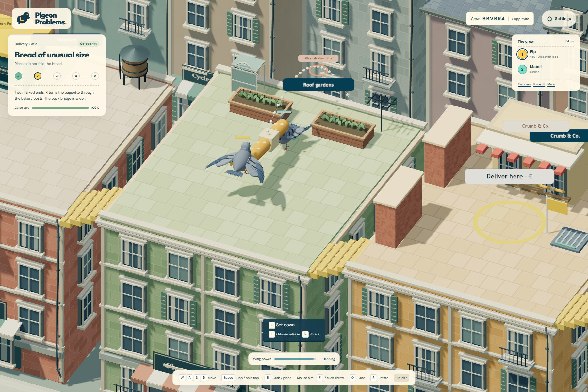
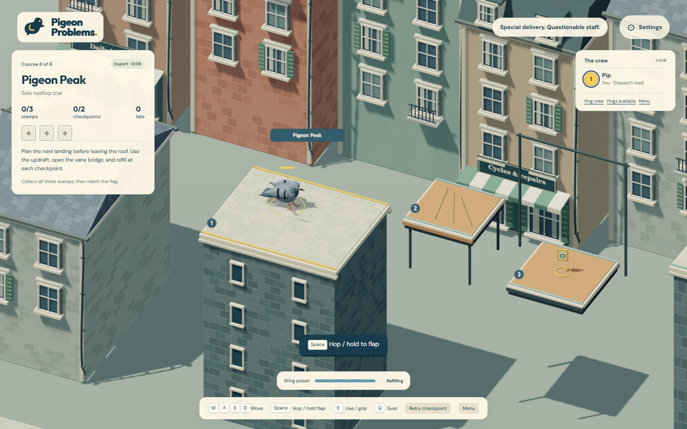
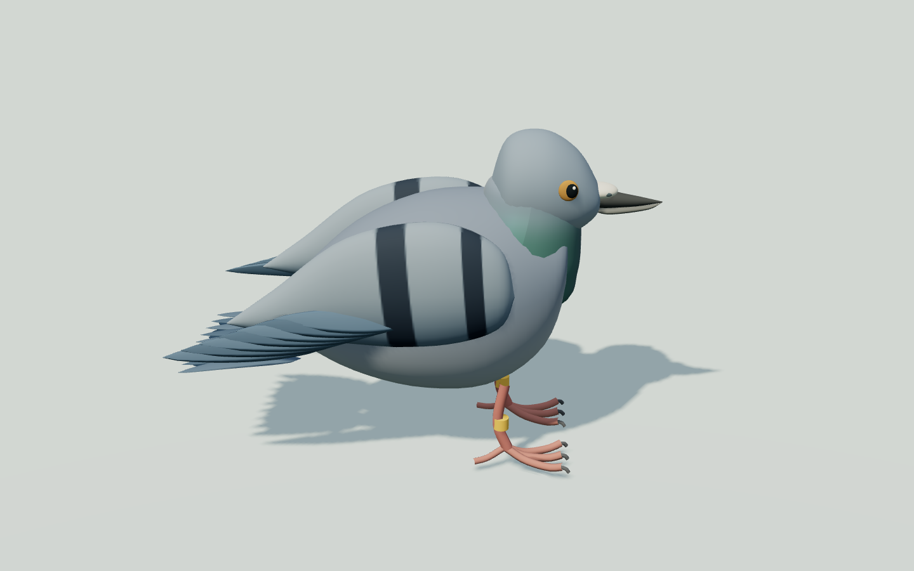
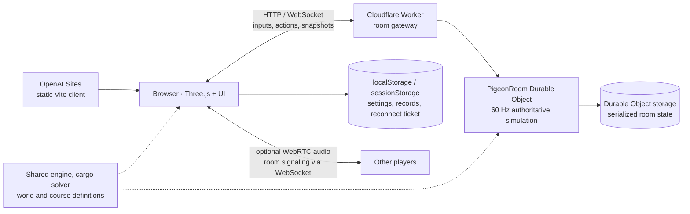

# Pigeon Problems

**Special delivery. Questionable staff.**

A 3D cooperative rooftop platformer for **1–4 players**. Haul a baguette twice your
size, catch a teammate's throw, and turn a dropped parcel into an improvised rescue.

**[Play live →](https://pigeon-problems.smoky-harp-3438.chatgpt.site/)** ·
[Run locally](#run-locally) · [Architecture](docs/architecture.md) ·
[Technical case study](docs/portfolio-case-study.md)

[](https://github.com/rmaytr/Pigeon-Problems/actions/workflows/ci.yml)



*An actual online two-player delivery: shared beak grips, flapping, cargo care and a collision-aware throw preview.*

## The game

Run a very professional delivery company staffed entirely by pigeons. Create a
private room, share its invitation link, and give every player their own camera.
No account or installation is required to play the hosted game.

- **Five deliveries** across six connected rooftops: a parcel, oversized bread,
  fragile eggs, a wind-sensitive sail and a tiered cake. Permanent detours keep
  deliveries recoverable; an Express replay adds a timed medal run.
- **Six platforming trials**, with **50 authored platforms and 18 stamps**:
  moving decks, updrafts, timed shutters, temporary bridges, crumbling perches,
  rotating hazards and a freight lift. Play solo or with a crew.
- **Cooperation through physical interaction:** carry opposite ends, rotate long
  loads, throw and catch, and gust a teammate toward the next landing. Unsupported
  cargo ends sag and drag against the floor.
- **Continuous aiming:** mouse, touch drag or right stick controls aim and power.
  The body follows movement; the head has a bounded rotation range.
- **Recovery without restarting the evening:** shared checkpoints, quick retries,
  reconnect identity, automatic dispatch-lead transfer, rematches and saved local
  best times/medals.
- **Optional communication:** WebRTC voice, four contextual pings and pigeon
  emotes. Voice enters muted and is independent of the game connection.
- **Original procedural art and audio:** modeled pigeons, generated surface
  textures, movement-driven animation, layered architecture and synthesized sound.
  Keyboard remapping, touch controls and reduced motion are included.


*Pigeon Peak combines limited flight, timing and narrow landings. Every trial supports 1–4 players.*

<details>
<summary>Character detail and recorded gameplay</summary>


*A development model inspection render of the same procedural character used in-game.*

Recorded gameplay: [rooftop trial keyboard run](evidence/rooftop-trials-demo.webm)
and [grounded movement and carrying](evidence/grounded-demo.webm).
These are saved development recordings, not staged feature mockups.

</details>

## Engineering

The same JavaScript simulation runs in the browser, the local Node server and
the production room service. The server owns movement, cargo, interactions and
score. Clients send bounded input/action intents rather than authoritative positions.



Local development replaces the Worker/Durable Object adapter with a Node
HTTP/WebSocket server and Vite middleware. It uses the same `Room` and engine;
no cloud account or database initialization is needed.

| Layer | Technology | Responsibility |
|---|---|---|
| Language and interface | JavaScript ES modules, HTML, CSS, SVG | Game logic, responsive UI and native input |
| Rendering | Three.js **0.180.0**, WebGL, Canvas textures | Procedural geometry, materials, shadows, animation and batching |
| Local backend | Node.js **24+**, ws **8.22.0** | HTTP, WebSockets and development rooms |
| Production backend | Cloudflare Workers, Durable Objects | Per-room authority and durable room snapshots |
| Communication | WebSockets, WebRTC, Web Audio API | Game transport, optional peer voice and synthesized audio |
| Build and verification | Vite **7.3.7**, Playwright **1.64.1**, Node test runner | Bundling, real browser checks and simulation/session tests |
| Deployment tooling | Wrangler **4.152.0**, OpenAI Sites | Independent backend and static client releases |

Package versions come from the lockfile. The project uses vanilla JavaScript;
there is no TypeScript compilation or separate typecheck command.

**Key decisions**

- A fixed **60 Hz** simulation, target **30 Hz** input and **20 Hz** snapshots
  separate gameplay rules from rendering and network frequency. Local movement
  prediction, sequence acknowledgments/replay and remote interpolation reduce
  perceived latency.
- A purpose-built cargo solver couples loads to one or two beak anchors, with
  damped rotation and sampled floor contact. The throw preview reuses the same
  free-cargo integration. World collisions use simplified AABBs.
- Room snapshots persist about every five active seconds and when idle. A sudden
  server loss can roll progress back by that interval. Empty rooms stop simulating.
- Reconnect tickets stay out of crew snapshots. Input bounds, action deduplication,
  ownership checks, origin restrictions and rate limits live on the server.

See [architecture and module responsibilities](docs/architecture.md) and the
[full technical case study](docs/portfolio-case-study.md) for tradeoffs and details.

## Run locally

Use **Node.js 24 or newer**, npm and a WebGL-capable browser. Node 24 is the CI
target; the original game was developed with Node 25. From the repository root:

```sh
git clone https://github.com/rmaytr/Pigeon-Problems.git
cd Pigeon-Problems
npm ci
npm run dev
```

Open **[http://127.0.0.1:5173](http://127.0.0.1:5173)**. Open another tab/browser
and use the room invitation to test multiplayer locally. Local room state is
in memory and resets when the Node process stops.

No environment file, API key, Cloudflare account or database is required.
[`.env.example`](.env.example) documents the optional public backend URL for a
separate deployment. Never put secrets in `VITE_*` settings; they enter the bundle.

```sh
npm test                 # 62 simulation, session and voice lifecycle tests
npm run build           # static production client -> dist/
npm run test:integration # starts/stops a local server; real WebSocket checks
npx playwright install chromium
npm run test:ui         # starts/stops local server; 65 checks in bundled Chromium
```

On Linux, use `npx playwright install --with-deps chromium` to install required
system libraries too. To use an installed Google Chrome, set `BROWSER_CHANNEL=chrome`
in your shell before running `npm run test:ui`. See [development](docs/development.md)
for PowerShell examples, individual suites, ports and troubleshooting.

`npm run preview` previews built static files only. Use `npm run dev` for local
multiplayer. The GitHub workflow builds and tests locally; it never deploys or
connects to the production game.

## Controls

| Action | Keyboard / mouse | Standard gamepad |
|---|---|---|
| Move | WASD / arrows | Left stick |
| Aim / throw strength | Mouse position | Right stick |
| Hop / hold to flap | Space | A |
| Grab / catch / place / use vane | E | X |
| Throw | Hold left mouse, release / F | B / right trigger |
| Directed gust | Right mouse / Q | Y |
| Rotate cargo | R | Right bumper |
| Ping / emote | 1–4 or V / C | Start menu |
| Rescue pigeon / recall cargo | T / Y | Back / menu |

Touch uses a movement pad and labeled action buttons; drag Throw to aim and
release. Keyboard-only aiming follows movement; Shift temporarily selects that
fallback after mouse input. Desktop keyboard/mouse is recommended for precise passes.

## Verification and measured results

The [CI workflow](.github/workflows/ci.yml) installs the lockfile on Node 24,
checks documentation links and images, runs core tests, builds the client,
and exercises a local server through WebSocket and browser suites. Its badge above
shows the actual latest GitHub result.

| Evidence | Scope |
|---|---|
| **62 core tests** | Gameplay rules, cargo physics, sessions, validation, recovery and voice lifecycle |
| **65 scripted browser checks** | 20 core, 15 art/aim, 13 trial UI and 17 release edge cases |
| **Six complete routes, 2- and 4-client crews** | Saved public WebSocket runs, identical crew results and rematches |
| **300 ms added round-trip latency** | Historical proxy run: bounded movement, stale-input stop and checkpoint rescue |
| **60.2 fps / 16.8 ms p95 frame interval** | Historical four-second 1440 × 900 local headless Chrome expert-course sample; 100 draw calls, 146,966 reported triangles |

Saved reports are dated **October 26, 2026** and remain historical evidence.
They are not overwritten by CI. Frame measurements describe specific short local
samples, not a hardware-independent performance guarantee. Browser inputs and
microphones are automated/simulated; they do not establish human enjoyment,
physical-controller compatibility or microphone intelligibility.

[Verification methodology and reproduction](docs/verification.md) explains the
current checks, saved reports and remaining validation gaps.

## Explore the source

```text
src/          Shared simulation, level definitions, rendering, input and UI
server/       Local Node adapter, Room protocol and Cloudflare Worker adapter
tests/        Node tests, real WebSocket pilots and Playwright browser scripts
scripts/      Managed local verification and documentation checks
public/       Original favicon
docs/         Architecture, development, case study, notices and authentic visuals
evidence/     Curated historical reports and two gameplay recordings
submission/   Contest description and screenshot provenance
.github/      CI workflow and contribution templates
```

## Project context and next steps

This was an **AI-assisted development project using OpenAI Codex**. The project
owner directed the concept, cooperative mechanics, visual and movement revisions,
level difficulty, review and submission priorities. Codex assisted with code,
procedural art, automated checks, documentation and deployment work. The case study
describes the implementation and evidence without implying unaided authorship.

The main engineering challenges were keeping multiplayer movement responsive,
making shared cargo predictable, coupling natural head/wing animation to gameplay,
and recovering cleanly from asynchronous socket and microphone events.

Priorities for further work:

1. Newcomer playtests and cooperative level/balance iteration with separate humans.
2. Physical controllers, Safari/Firefox, real phones and lower-end GPU testing.
3. Sustained load/soak testing and stronger operational observability.
4. Evaluate a TURN relay for restrictive networks; current voice uses STUN only.

Best records are device-local. There is no account system or cross-device record
sync. The cargo simulation is intentionally constrained, and no sustained
production concurrency or test-coverage percentage is claimed.

## Contributing and attribution

See [contributing](CONTRIBUTING.md), [third-party notices](docs/third-party-notices.md)
and [deployment notes](docs/deployment.md). Models, textures, UI art and synthesized
audio are original procedural work. Fonts and dependencies retain their own licenses.

**Project license: not yet selected by the owner.** No project-wide open-source
license is granted in this publication. Public source availability and third-party
licenses are separate; choose a project license before inviting code reuse.
